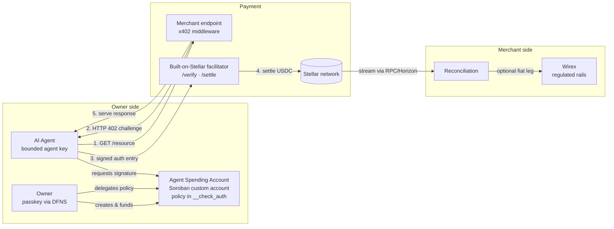
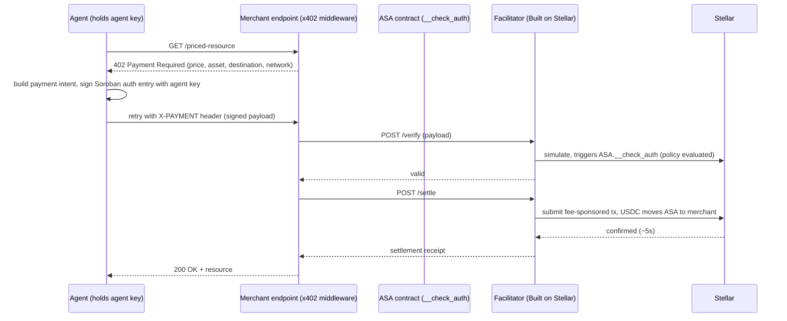

# Agent Spending Accounts on Stellar: Canonical Architecture Specification

**Status:** Design specification, v1.0 (October 2026)
**Authors:** Vottun (Neutral Agent Pay) · Lead partner: Wirex · Key infrastructure: DFNS
**License:** Contracts and SDK described here will be released under an open-source license with verified mainnet deployments (see [§10](#10-open-source-plan)).

This is the single canonical specification for the **Agent Spending Account (ASA)** primitive and the Neutral Agent Pay stack built on it. It consolidates the full design referenced from our Stellar Community Fund submission; nothing is split across other documents.

---

## Table of contents

1. [Motivation](#1-motivation)
2. [Design goals](#2-design-goals)
3. [System overview](#3-system-overview)
4. [The Agent Spending Account primitive](#4-the-agent-spending-account-primitive)
5. [The x402 payment flow](#5-the-x402-payment-flow)
6. [Key model (DFNS)](#6-key-model-dfns)
7. [Settlement, reconciliation and the fiat leg (Wirex)](#7-settlement-reconciliation-and-the-fiat-leg-wirex)
8. [The payer-path question and its fallback](#8-the-payer-path-question-and-its-fallback)
9. [Reference agents](#9-reference-agents)
10. [Open-source plan](#10-open-source-plan)
11. [Security considerations](#11-security-considerations)
12. [Out of scope](#12-out-of-scope)

---

## 1. Motivation

AI agents are becoming economic actors: they buy data, inference, and services per call, and consumer agents (Meta's Muse, Instinct) have made delegated agent spending a mainstream question. The question nobody has answered well is: **what account do you give your agent to spend from?**

Today's answers are:

- **A credit card handed to a bot.** Unbounded exposure, no programmable control, and card rails whose fixed fees make per-call payments economically impossible.
- **A custodial prepaid balance.** A third party holds the funds. The owner gets a balance cap at best, with no allowlists, no velocity limits, no on-chain auditability, and counterparty risk.
- **A raw crypto key given to the agent.** Full self-custody but zero safety: a compromised or misbehaving agent can drain the account.

The Agent Spending Account is the fourth answer: **a self-custodial Soroban smart account that delegates bounded spending authority to agents, with every rule enforced on-chain at authorization time.** The owner keeps custody; the agent gets a policy, not a key to the vault.

Stellar is the right settlement layer for this because (a) Soroban's custom account model (`__check_auth`) makes programmable authorization a first-class primitive, which is what on-chain spending policy requires; (b) ~5-second finality and sub-cent fees make per-query micropayments viable; (c) native USDC/EURC provide regulated settlement assets; and (d) a live x402 facilitator (Built on Stellar, operated on OpenZeppelin's Relayer infrastructure) already serves the verify/settle flow.

## 2. Design goals

| Goal | Meaning |
|---|---|
| Self-custodial | Neither Vottun, DFNS nor any operator can move owner funds. The ASA contract is controlled by the owner's credentials. |
| Policy on-chain | Caps, allowlists, velocity limits and expiry are evaluated **inside `__check_auth`** at authorization time, not in middleware that an agent could bypass. |
| Zero crypto exposure for end users | Passkey onboarding via MPC; no seed phrases, no trustline management, no XLM handling, no token UX. |
| Rail-reuse, not rail-duplication | We consume the ecosystem's x402 facilitator and our SCF-funded SDK components rather than building parallel infrastructure. |
| Reusable primitive | The ASA contracts are open source and agnostic to the agent platform: any wallet, bot framework, or application can adopt them. |
| Clean fiat exit | Merchants can take settled stablecoin as a reconciled fiat balance through a regulated partner (Wirex), with a 1:1 mapping between fiat ledger entries and Stellar transactions. |

## 3. System overview



**Components:**

| Component | Base | Role |
|---|---|---|
| Agent Spending Account (ASA) | Soroban custom account contract | Owner-held account; enforces delegation policy in `__check_auth` |
| x402 engine & SDK | x402 standard + Built-on-Stellar facilitator | Merchant middleware (402 challenge/response) and agent client (challenge detection, signature request, retry) |
| Key abstraction | DFNS MPC | Owner passkeys, bounded agent keys, trustline setup, all abstracted behind the SDK |
| Settlement & reconciliation | Custom contract + Horizon/RPC streaming | Merchant settlement; per-transaction fiat↔chain mapping; no standalone indexer |
| Fiat leg | Wirex | Optional conversion of settled USDC/EURC into a reconciled fiat balance |
| Reference agents | Telegram (Alpha Agent) · WhatsApp (masBares) | Consumer and business ASAs exercised end-to-end on mainnet |

## 4. The Agent Spending Account primitive

### 4.1 Account model

An ASA is a **Soroban custom account**: a contract that holds balances (USDC/EURC via SAC) and implements the `CustomAccountInterface`, so every authorization it grants passes through its own `__check_auth` implementation.

Two classes of credentials control it:

- **Owner credential:** a secp256r1/WebAuthn passkey (managed through DFNS). The owner can: fund and withdraw, create/modify/revoke delegations, and rotate keys. Owner operations require the owner credential; no delegation can ever authorize them.
- **Agent credentials:** one ed25519 key per delegated agent, held by the agent runtime (provisioned via DFNS service accounts). An agent key can authorize **only payment operations that satisfy its delegation policy**.

### 4.2 Delegation policy

Each delegation is a struct stored in the ASA's contract storage:

```rust
pub struct Delegation {
    pub agent_key: BytesN<32>,        // the agent's ed25519 public key
    pub max_per_tx: i128,             // cap per payment
    pub max_per_day: i128,            // rolling 24h cap (ledger-time based)
    pub max_total: i128,              // lifetime cap for this delegation
    pub spent_today: i128,            // sliding-window accounting
    pub spent_total: i128,
    pub window_start: u64,            // ledger timestamp anchoring the daily window
    pub allowlist: Vec<Address>,      // permitted payee addresses (merchants / settlement contracts)
    pub max_tx_per_window: u32,       // velocity limit (count-based)
    pub tx_in_window: u32,
    pub expires_at: u64,              // ledger timestamp; delegation is void after this
    pub revoked: bool,                // owner kill-switch, effective immediately
}
```

### 4.3 `__check_auth` logic

On every authorization request signed by an agent key, the contract:

1. Verifies the signature over the Soroban authorization payload (standard ed25519 verification).
2. Looks up the delegation for that key; **rejects** if none, revoked, or expired.
3. Extracts the payment intent from the authorized invocation (payee, asset, amount).
4. Enforces: `amount <= max_per_tx`; `spent_today + amount <= max_per_day` (rolling the window if `now - window_start > 24h`); `spent_total + amount <= max_total`; `payee ∈ allowlist`; `tx_in_window < max_tx_per_window`.
5. On success, updates the spend counters **in the same invocation** (no TOCTOU gap: policy accounting is transactional with the payment authorization).
6. Owner-credential requests skip delegation checks and verify the WebAuthn signature instead.

Out-of-policy requests fail **before any funds move**. The enforcement is part of authorization itself rather than a wrapper an integrator could forget.

### 4.4 Why this is a primitive, not an app feature

The ASA makes no assumptions about what the agent is or where it runs. Anything that can hold an ed25519 key and sign a Soroban auth entry (a Telegram bot, a WhatsApp agent, a LangChain tool, another contract) can be a delegate. Any wallet or platform can offer "give your agent a budget" by deploying or integrating these contracts. That is the gap in the current x402 landscape: existing tooling serves the **seller** side (facilitators, merchant middleware); the ASA is the **spender** side.

## 5. The x402 payment flow

End-to-end sequence for one paid call:



Notes:

- The **merchant middleware** (our SDK, server-side) declares paid endpoints and prices in configuration; it never touches keys.
- The **agent client** (our SDK, agent-side) detects 402 challenges, requests a signature from the agent's DFNS-held key, and retries. Confirmation handling, retries and error normalization wrap the facilitator calls.
- The facilitator constructs, fee-bumps and submits the settlement transaction, so neither the agent nor the ASA needs XLM for fees.
- SDK reuse: wallet provisioning, transaction lifecycle, configuration and streaming components come from the SCF-funded **Wirex–Vottun–Stellar SDK**; the x402 engine and the ASA client are the new layers.

## 6. Key model (DFNS)

| Key | Type | Held by | Can do |
|---|---|---|---|
| Owner passkey | secp256r1 / WebAuthn | Owner's device, MPC-backed via DFNS | Fund, withdraw, delegate, revoke, rotate |
| Agent key | ed25519 | Agent runtime, provisioned via DFNS service account | Sign payment auth entries only; useless outside its delegation |

Properties:

- **No seed phrases anywhere.** Owner onboarding is a passkey ceremony; agent keys are provisioned programmatically.
- **DFNS is infrastructure, not a custodian**: keys are MPC-sharded; DFNS cannot unilaterally sign, and no DFNS credential can satisfy the ASA's owner checks on its own.
- **Compromise containment**: a leaked agent key is bounded by its delegation (caps, allowlist, expiry) and killed by one revocation call. The blast radius is the remaining daily budget, not the account.
- DFNS license costs are borne by Vottun as an operating cost (not part of any grant budget).

## 7. Settlement, reconciliation and the fiat leg (Wirex)

**On-chain settlement** is native USDC/EURC on Stellar via the facilitator. Merchants integrate the SDK middleware and receive funds to their settlement address (a plain account or a settlement contract when per-merchant accounting is needed).

**Reconciliation** streams settlement events over Horizon/RPC (no standalone indexer): each inbound payment is matched to its x402 challenge (request id ↔ memo/event correlation) and surfaced in a lean operator view: merchant, endpoint, request id, amount, tx hash, timestamp.

**Fiat leg (optional, per merchant):** merchants onboarded by Wirex (KYB performed by Wirex inside its regulated perimeter) can convert settled stablecoin into a fiat balance on Wirex's rails. The reconciliation view maps **every fiat ledger entry 1:1 to its on-chain transaction**, producing the audit trail finance teams require. Wirex operates live dual-stablecoin USDC/EURC settlement on Stellar today; this reuses its production rails rather than building a conversion layer.

**Regulatory responsibility model:** Wirex (regulated payments entity) owns KYB and fiat; DFNS provides key infrastructure, not custody; Vottun provides software. ASAs are self-custodial. The stack performs **no bridging, no FX, no token issuance, and no yield**.

## 8. The payer-path question and its fallback

The design's critical technical assumption is that a **Soroban custom account can act as the x402 payer through the facilitator**, i.e. that the facilitator's verify/settle flow accepts authorization entries whose credential is a contract address validated via `__check_auth`, and fee-bumps the resulting transaction.

This was flagged in our previous SCF round, and we manage it explicitly:

1. **This spec publishes the full payer path** (§4–§5) so it can be evaluated on its mechanics.
2. **Facilitator confirmation:** we are in contact with the Built-on-Stellar facilitator team (OpenZeppelin Relayer + x402 Facilitator Plugin) to confirm custom-account payer support and mainnet conditions in writing; the submission references the outcome.
3. **Gated validation spike (first funded deliverable, weeks 1–2):** a runnable proof (public repo, testnet transaction hashes, recorded demo) of an ASA signing x402 auth entries through DFNS-held keys and settling via the facilitator, with an explicit go/no-go gate before any dependent work begins.

**Fallback path (fully specified):** if the facilitator cannot settle contract-credential payers, enforcement moves to two cooperating layers with identical user-facing guarantees: (a) the **DFNS policy engine** enforces the delegation (caps, allowlist, velocity, expiry) at signature time, meaning the agent's signing request is evaluated against the owner's policy before any signature exists; and (b) a **settlement contract** on the payment path re-validates payee and amount on-chain. The ed25519 account used as payer is then a standard x402 payer the facilitator already supports. The trade-off is that cap accounting shifts from contract storage to policy-engine state, with the on-chain contract retaining allowlist/amount validation; delegations, revocation semantics and the owner experience are unchanged.

## 9. Reference agents

Two working agents ship within the award and generate verifiable mainnet volume, one in each ASA mode.

### 9.1 Alpha Agent (consumer ASA, Telegram, crypto-native)

A market-intelligence agent users talk to on Telegram. Per query, it purchases the data the answer needs (social sentiment, on-chain analytics, token safety scans) via x402, paying **at least one third-party x402 data service** (ecosystem interoperability) and **one Vottun-operated endpoint monetized with the funded SDK** (making SDK usage publicly observable on-chain). Typical policy: $5/day cap, three allowlisted providers, 7-day expiry, one-message revocation.

Boundaries: information only. No trade execution, no investment advice, no custody of user trading funds. Sponsored listings, where shown, are clearly labeled, paid via x402 themselves (the advertiser side of two-sided agentic payments), and **never affect organic analysis or ranking**.

### 9.2 masBares (business ASA, WhatsApp, non-crypto, in production)

masBares is Vottun's live WhatsApp agent that creates and publishes social content for bars and local businesses. Under this design it pays its per-use AI consumption (image generation, model inference) from a **business ASA**: the owner tops up a budget in one step; the agent spends within caps and a provider allowlist; the owner sees a budget and an expense report, never a wallet, a key, or a token. This demonstrates the same primitive serving mainstream SMEs with zero crypto exposure.

## 10. Open-source plan

Released under an open-source license, with verified mainnet deployments:

- The **ASA contracts**: policy enforcement (`__check_auth`), delegation management, settlement contract.
- The **owner/agent key-model reference** (DFNS integration patterns, provisioning flows).
- The **x402 integration patterns** for the Built-on-Stellar facilitator (merchant middleware and agent client usage, with quickstarts for merchant, agent, and ASA owner).

The reference agents' conversational products (Alpha Agent, masBares) remain Vottun products; their ASA integrations are documented as public reference implementations. Positioning: an ecosystem primitive any Stellar wallet, bot framework or application can adopt, not a Vottun-only component.

## 11. Security considerations

- **TOCTOU:** spend counters update inside the same authorized invocation that moves funds; there is no window between policy check and payment.
- **Replay:** Soroban authorization entries carry nonces and expiration ledgers natively; the contract relies on standard auth-entry semantics.
- **Key compromise:** owner passkey compromise requires the owner's device + biometrics (WebAuthn); agent key compromise is bounded by the delegation and revocable instantly.
- **Facilitator trust:** the facilitator can censor (refuse to settle) but cannot move funds outside a signed, policy-passing authorization; settlement is verifiable on-chain.
- **Contract risk:** audited patterns where available, failure-injection testing on testnet, and SDF Audit Bank review of the ASA contracts before mainnet deployment.
- **Data services:** the Alpha Agent treats purchased data as untrusted input; provider responses never alter policy state.

## 12. Out of scope

Fiat on-ramps for end users; cross-chain bridging or FX; token issuance; yield on balances; trade execution or investment advice in any reference agent; marketing; legal opinions; DFNS license fees (borne by Vottun). The security audit is requested through the SDF Soroban Security Audit Bank rather than funded from the award.

---

### Document history

| Version | Date | Change |
|---|---|---|
| 1.0 | 2026-10-22 | First canonical consolidated specification (supersedes all prior partial architecture material). |

**Contact:** Sergi Mias, Product Manager & Blockchain Developer, Vottun · smias@vottun.com
